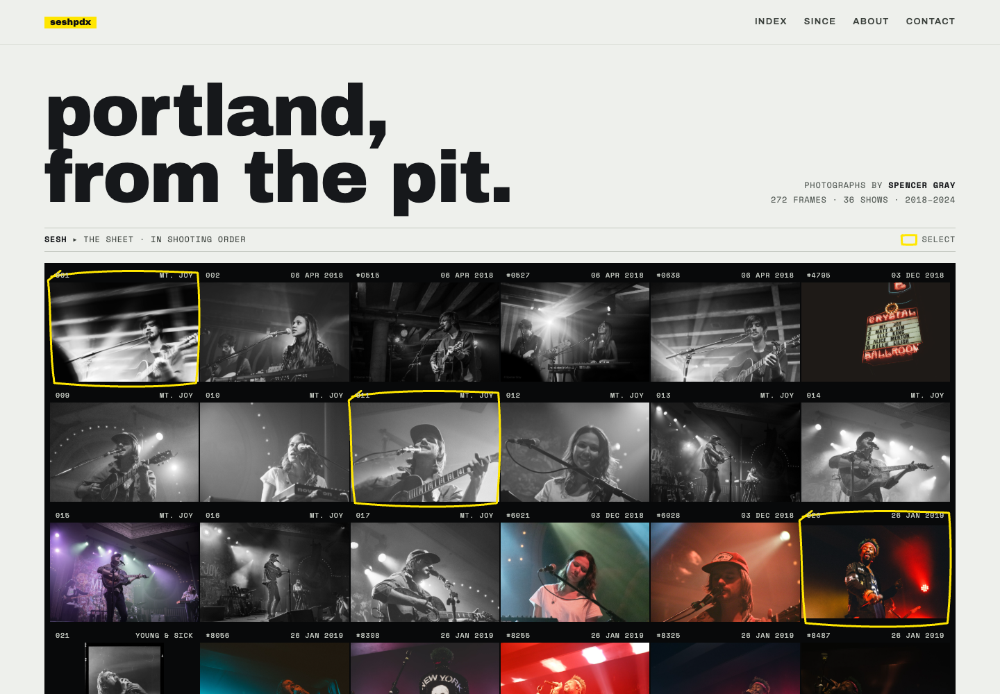
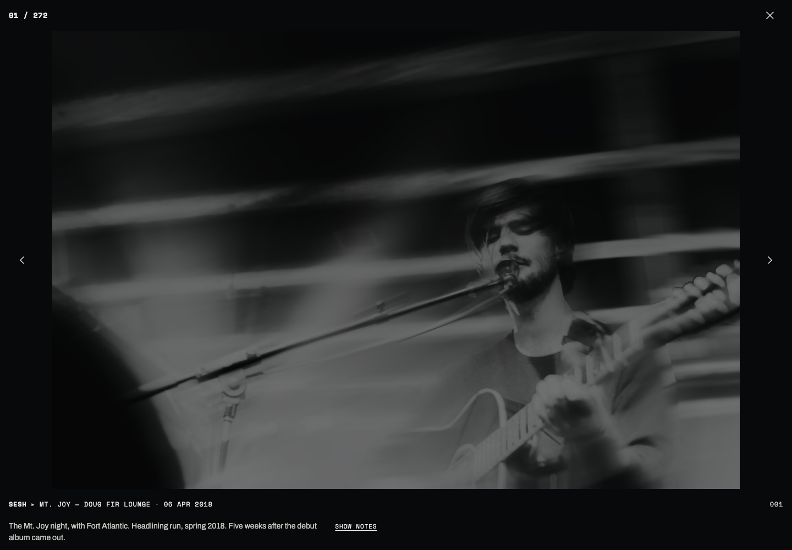
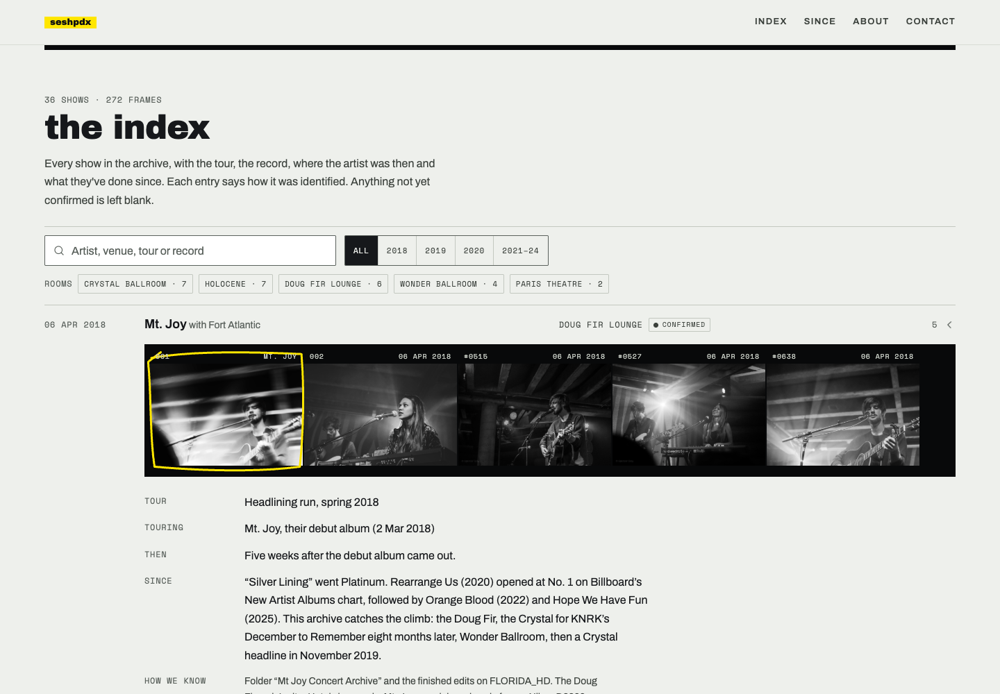
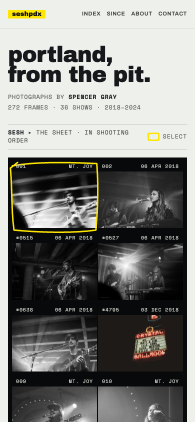

# seshpdxphotos

**Portland, from the pit.** Spencer Gray’s live-music photography portfolio: 272 photographs and 36 annotated show entries spanning 2018–2024.

[View the live portfolio](https://seshpdxphotos.vercel.app/)

The site presents a chronological contact sheet, selected frames, and a searchable concert index. Show entries connect photographs with artists, venues, tours, records, identification evidence, and source links. Unconfirmed details retain the uncertainty labels supplied in the original archive.

## Screenshots

### Desktop


### Frame viewer


### Show index


### Mobile


## Features

- Chronological contact sheet with 272 photographs and marked selections.
- Full-screen frame viewer with keyboard arrows, Escape, swipe navigation, and show notes.
- Show search, year filters, venue shortcuts, and expandable evidence/source notes.
- Direct links to frames (`/#frame-001`) and shows (`/#show-S19`).
- Responsive layouts and automatic light/dark appearance.
- Contact email copy action for coverage, licensing, and photo passes.

## Run locally

No build step, package installation, API keys, or backend is required.

```sh
python3 -m http.server 4173
```

Open `http://localhost:4173`. The site uses plain HTML, CSS, and JavaScript with local JPEG assets. Google Fonts supplies Archivo, Archivo Black, and Space Mono; system fonts are fallbacks.

## Deployment

Vercel project: `seshpdxphotos`. Framework preset: Other. Output directory: repository root. `vercel.json` defines static hosting, and `.vercelignore` excludes repository documentation/screenshots from deployment uploads.

## Editing

Page layout, styling, and application logic live in `index.html`. The `FR` array stores frame metadata and the `SH` array stores show records. Photographs live in `img/`. Preserve the file identifiers when editing to keep existing frame links working.

## Source and rights

Imported from the supplied `seshpdx-Portfolio-updated.zip`; see [source provenance](SOURCE.md). The supplied photographs and show content are preserved. All frames © Spencer Gray. Contact the photographer for licensing; this repository does not grant reuse rights to the photographs.
